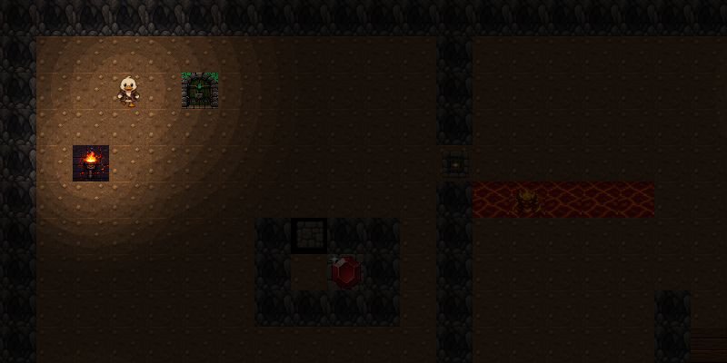
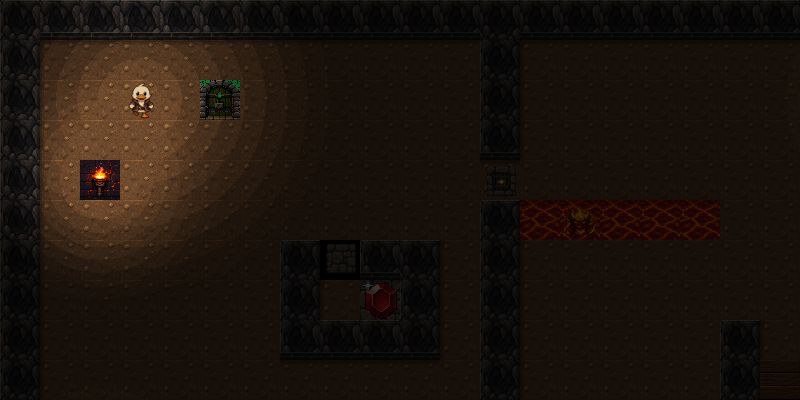
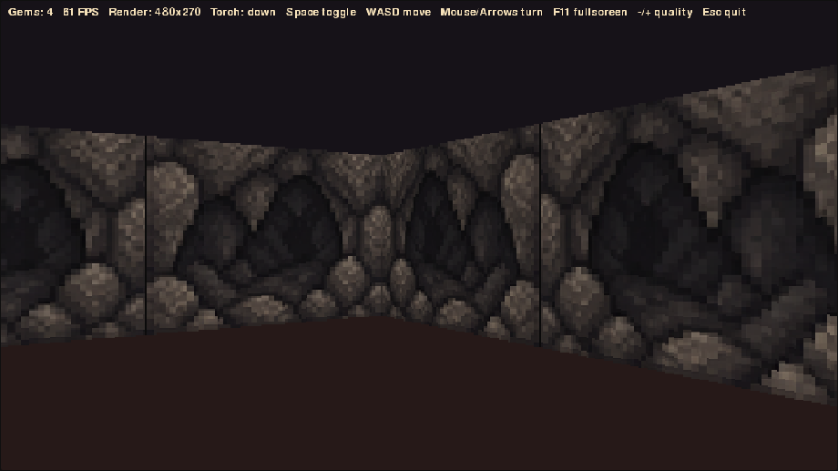

#tu es la canard 

## Run the game

```bash
python3 runtime/main_menu.py
```

Choose a level, then play the same CSV map in either the 2D or ray-cast mode.

## Gameplay screenshots

### 2D wall styles

The top-down renderer defaults to neighbour-aware pseudo-3D stone walls. Press
`V` during a 2D level to switch between the enhanced and original rendering;
the map, collisions and lighting remain identical.

| Classic | Pseudo-3D |
| --- | --- |
|  |  |

Set `CANARD_WALL_STYLE=classic` before launch to start with the original style,
or `CANARD_WALL_STYLE=pseudo3d` to start with the enhanced style. The first-person
raycaster continues to use the original texture assets and rendering path.

### Ray-cast dungeon



### Controls

- Arrow keys: move in 2D
- WASD / arrows / mouse: move and turn in ray-cast mode
- Space: toggle the player's torch
- V: switch between classic and pseudo-3D walls in 2D
- M: toggle music
- Enter: select menu item
- Escape: return or quit

Raising the torch increases visibility, slows the duck, and makes every demon
1.5x faster. Nearby hidden doors are permanently opened when revealed. One-way
gate arrows show the direction the duck may travel. The Tutorial (stored as
`map5.csv`) is a complete puzzle level demonstrating gates, a hidden torch
door, demons, and collapsing floors.

## Map editor

Run the visual CSV editor with:

```bash
python3 map_editor.py
```

It opens `map1.csv` by default. Pass another map path to open it directly:

```bash
python3 map_editor.py maps/game/map4.csv
```

Blank CSV cells remain blank and are distinct from background object `0`. Hold the arrows, WASD, or Vim-style H/J/K/L keys to move continuously; moving beyond the right or bottom edge expands the map. Shift-H/J/K/L and the mouse wheel pan larger maps. Horizontal wheel gestures pan sideways, and Shift+vertical wheel is the fallback. Left-click and drag to paint continuously. Right-click and drag or press Delete to make cells blank. Q/E changes the catalogue selection.

Press `:` for Vim-style commands: `:w`, `:q`, `:wq`, `:q!`, and `:e`. Press `?` to show or hide the complete controls overlay. The palette is loaded from `rules/objects.csv`, so new catalogue entries appear automatically.

'''
a dungon puzzle explorere, where you the duck enter hell and battle deamons. 
a map and level build framework implimented in python & and clickly clickly excel. 
'''


## dir structure and plan 

home/ 
|---maps/
|   |--- map1.csv       #containers raw level configuration WORLD STATE
|
|---rules/ 
|   |--- objects.csv   # containes and describes objects in maps. OBJECT DEFINIATION
|   |--- movement.py   # describes movement of player and enemies. 
|   |--- colsion_ruels.py # rules for interaction between objects and players. 
|   |--- level_loader.py   # cordinates level choice and maps loaded. 
|
|---Source/ 
|   |--- map1.ods      # map editor source file.
| 
|---Assets/ 
|   |---sprits/        #png images 
|   |--- audio/        #sound affects music
|
|---Scripts
|   |--- main_menu.py       # menu screen/ death screen/ level picker. 
|   |--- score_timer.py     # clock timer, some kind of higher score per level. 
|   |--- scores.csv         # saves highscore data
|   |--- main.py            # Master script.  
|
|---launcher.py             # Main urnnng script
|---README.MD               # repo instructions/ plan / this doc 
